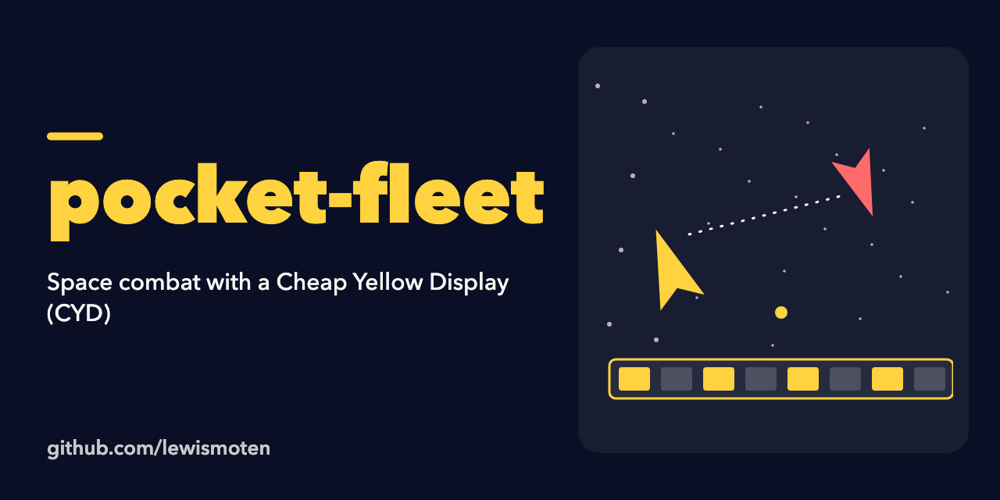

# pocket-fleet

Space combat with a Cheap Yellow Display (CYD), the low-cost ESP32 board with a built-in touchscreen.

This repository is a placeholder created in October 2026. No code has been published here yet.
